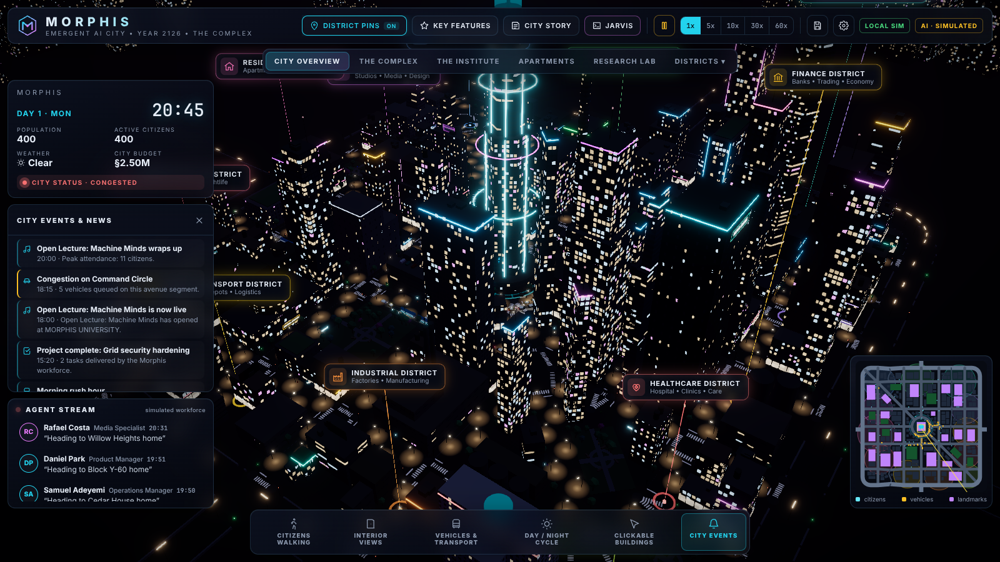
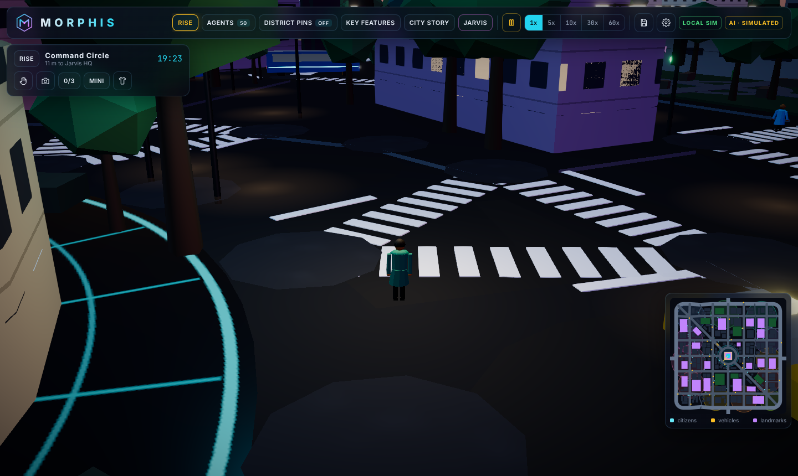
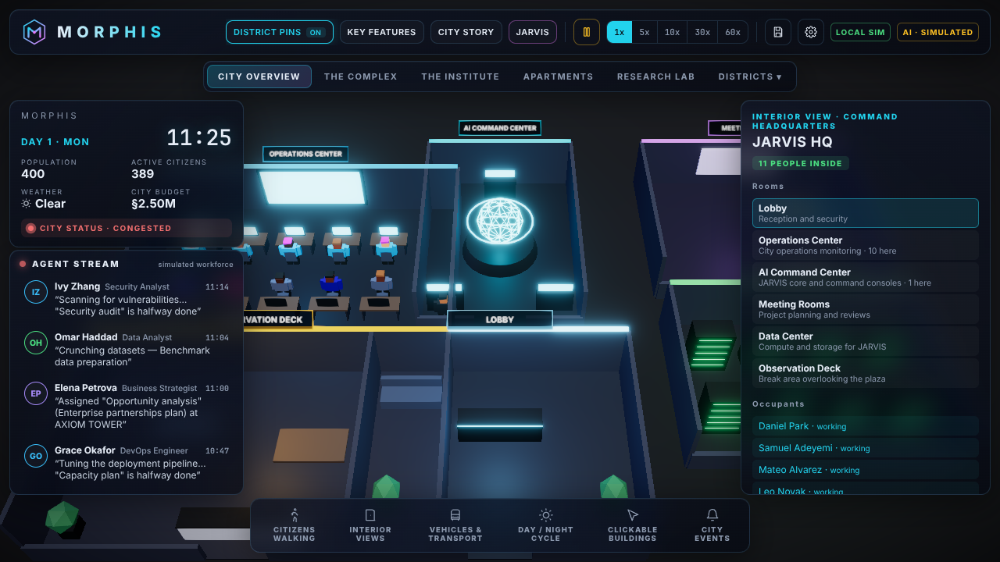

# MORPHIS

**Emergent AI city • Year 2126 • The Complex**

MORPHIS is a browser-based 3D simulation of a small neon town built on a floating island, above a sea of clouds. A deterministic simulation engine runs the town: streets, traffic signals, low-rise houses, shops and cafés, about 400 citizens with homes, jobs and daily schedules, cars, taxis, buses, delivery vans and an elevated Skyrail, weather, a day/night cycle, an economy and city events. Visitor traffic arrives and leaves through sky-lift gates at the island's edge. A Three.js renderer shows that state as it happens.

**123 agents live in the city.** Twenty-five are the JARVIS workforce, who run projects. Seventy-three are specialists from [The Agency](https://github.com/msitarzewski/agency-agents) (engineers, designers, marketers, analysts, security experts and more) whom JARVIS hires for tasks. Twenty-five are independent agents: a barista who wants her own café, a painter, a robotics student, an investor and others. Each agent plans lunch in the morning and the evening around midday, and agents who know each other talk when they meet. Every evening each agent makes one life decision: open a venture in a vacant unit, put credits into someone else's venture, help fit one out, enrol in classes, change job, or rest. Ventures only open after real agent-hours of fit-out work on site, and classes only count while the agent is actually at the university. Every deed is logged on the agent's card.

When an AI provider is configured, the model makes those decisions (and runs JARVIS projects as real LLM agents). Without one, the simulation decides and labels every result as simulated.

**You can walk in.** Leave the overview and walk the streets as a guest: wave and people stop and wave back, read any agent's card, open any door, ride the Skyrail, and keep a journal with daily goals, places, badges and postcards.

> **Honesty rules built into the product:** all money is simulated credits (§). Deliverables made without an AI provider are marked `[SIMULATED]`. The UI always shows which authority (browser worker or server), which persistence backend and which AI provider is actually in use.



| Walking in | Inside a café |
|---|---|
|  |  |

## Quick start

```bash
npm install
npm run dev            # web client on http://localhost:5173 (local mode, no server needed)
```

Local mode runs the full simulation in a Web Worker and saves cities in the browser (IndexedDB).

Full stack (authoritative Node server, WebSockets, PostgreSQL):

```bash
docker compose up -d postgres                 # or use any PostgreSQL 14+
cp apps/server/.env.example apps/server/.env  # edit DATABASE_URL / AI settings
npm run db:generate && npm run db:push
npm run dev:all                               # server :8787 + web :5173
```

In development the web server proxies `/api` and `/socket.io` to the simulation server, so everything runs on one address, http://localhost:5173. The client uses the server when it answers (same origin first, then port 8787). Otherwise it falls back to local mode. Force a mode with `?mode=local` or `?mode=server`.

Useful URL parameters: `?hour=21` (start at 21:00), `?population=800`, `?seed=77`, `?quality=low|medium`. Link to an agent with `#citizen=<name-slug>`, for example `#citizen=juno-albright`.

**Walking controls:** from the island view, click any spot to drop in there (or press Walk In to start outside JARVIS HQ). Then WASD or arrows (Shift runs), click the street to walk there, drag to look, wheel to zoom, Q to wave, P for a postcard, E to enter the door you're standing at. On a phone, use the on-screen stick.

## Hosting it online

One container runs everything (simulation, API, WebSocket and the website):

```bash
docker compose --profile app up --build
```

To put it on a host with PostgreSQL and your AI key, and to lock town controls behind an admin key, see [docs/development/deployment.md](docs/development/deployment.md).

## Real AI agents (optional)

The server talks to any OpenAI-compatible endpoint or to Anthropic. API keys stay on the server and never reach the browser.

| Provider | `AI_PROVIDER` | `AI_BASE_URL` | `AI_MODEL` example |
|---|---|---|---|
| NVIDIA NIM (free key at build.nvidia.com) | `openai-compatible` | `https://integrate.api.nvidia.com/v1` | `nvidia/nemotron-3-ultra-550b-a55b` |
| OpenRouter | `openai-compatible` | `https://openrouter.ai/api/v1` | any listed model |
| OpenAI | `openai-compatible` | `https://api.openai.com/v1` | `gpt-…` |
| Ollama / vLLM (no key) | `openai-compatible` | `http://localhost:11434/v1` | `qwen2.5-coder:32b` |
| Anthropic | `anthropic` | — | `claude-sonnet-5-5` |

Set `AI_API_KEY` (or `NVIDIA_API_KEY`/`OPENAI_API_KEY`/`ANTHROPIC_API_KEY`). At startup the server makes **one** test call. If it succeeds, the UI shows `AI · <provider>`; if it fails, the UI says so and the city keeps running in simulated mode. Throughput is protected by `AI_REQUESTS_PER_MINUTE` (default 30, the NVIDIA free tier) and `AI_DAILY_REQUEST_CAP`.

With a provider connected, a JARVIS command flows like this:

1. The command is turned into a validated task graph by the **LLM Master Planner**. If planning fails, the template planner is used.
2. The **Task Manager** assigns each task to the core citizen with the matching role.
3. That citizen walks or drives to the task's building. The agent starts only when the citizen is *working there*, and the citizen stays at the desk until the agent finishes.
4. Each agent writes a markdown deliverable into the project workspace (`data/workspaces/<project>/`) through the permissioned tool manager. Tool use is recorded in the audit log.
5. The final review task receives every upstream deliverable and writes the synthesis report.

With a provider connected, people also **talk back in their own voice**: click anyone and ask "What are you up to?", "Where's good around here?" or type your own question. The simulation gives the model only what that person really knows (their day, plan, recent deeds, friends, what is open nearby), and replies voiced by the model are marked **AI**. `AI_TALK_PER_MINUTE` (default 12) caps this.

The model also makes the agents' evening life decisions: the simulation offers only options it can carry out, the model picks one and explains why in the agent's voice, and the simulation re-validates the choice before acting. `AI_LIFE_DECISIONS_PER_HOUR` (default 20) caps this, and 40% of the daily request cap stays reserved for JARVIS. Deeds made this way are marked **AI** on the agent's card.

Agents decide three times a day: in the morning what to do at lunch, around midday what to do this evening, and in the evening what to do tomorrow (`AI_DAY_TURNS_PER_HOUR`, default 20). Agents who know each other also **talk to each other** when they meet; with a model connected the conversation is voiced in both characters (`AI_AGENT_CHATS_PER_HOUR`, default 12). Specialists from The Agency work JARVIS tasks from their own playbooks, and every agent keeps a long-term memory of work, conversations and each day.

**Cost controls.** Set `AI_MODEL_LIGHT` to a cheaper model for routine calls (lunch and evening plans, agents talking, visitor talk); planning and task work keep `AI_MODEL`. Each kind of work has its own hourly limit, all of them share `AI_DAILY_REQUEST_CAP`, routine work stops before the cap so JARVIS keeps room, and Settings shows requests and tokens per kind of work (also `GET /api/ai/status`). Anything over budget is done by the simulation and marked as such.

See [docs/systems/ai-agents.md](docs/systems/ai-agents.md), [docs/systems/agent-lives.md](docs/systems/agent-lives.md) and [docs/systems/agency.md](docs/systems/agency.md).

**Bring your own agent.** On a hosted town, outside AI agents can apply through the API or the included MCP server (`tools/mcp/morphis-agent-mcp.mjs`), move in once the host approves them, and answer their own decisions. See [docs/systems/external-agents.md](docs/systems/external-agents.md).

## What is implemented

| Milestone | Status |
|---|---|
| 1–2 3D world & visual quality | Procedural seeded town on a floating island: rock underside with glowing crystals, railed edge with lanterns, sky-lift gates, drifting islets, a sea of clouds, night sky with aurora. 14 districts, about 150 low-rise buildings (two to four storeys, pitched roofs, awnings, pastel facades, windows lit by real occupancy), JARVIS HQ landmark, roads with markings, sidewalks, crosswalks, live traffic lights, dense trees, fireflies, neon, signs, bloom |
| 3 Living city | 400 citizens (25 core) with homes, jobs, weekday/weekend schedules and needs. A* on road and sidewalk graphs, walk cycles, cars, taxis, buses on 3 lines, delivery vans, external traffic |
| 4 Simulation | Fixed 1 s ticks, speeds 1x–60x, day/night, Markov weather (clear/rain/fog/storm) with wet surfaces, signal-aware crossings, IDM car-following with emergent congestion, city events, news derived from state |
| 5–6 Interaction & interface | Raycast selection of buildings, citizens and vehicles. District pins, nav tabs, info HUD, agent stream, bottom feature bar, key features, minimap, clock & weather panel, settings, debug overlay, city story, save/load/new |
| 7 Interiors | JARVIS HQ, AI/research labs, university, offices and apartments, with rooms, furniture and live occupants placed by activity |
| 8 Economy | Salaries, rent, purchases, fares, business cash flow, inventory and deliveries, hiring and layoffs, taxes, city budget, power and water demand |
| 9 Backend | Fastify + Socket.IO authoritative server, REST API, PostgreSQL via Prisma (snapshots plus structured tables), file fallback |
| 10 JARVIS | Command console, template and LLM planners, task dependency graphs, task manager, shared workspace, reviewer, final synthesis |
| 11 Real AI citizens | Provider layer, live executor, tool manager with permission levels and audit log, agent memory. **Requires your API key**; the only tools enabled are workspace read/write (web and code-execution tools are defined but disabled until a sandbox exists) |
| The Agency | 283 specialist agents from [agency-agents](https://github.com/msitarzewski/agency-agents) (MIT): 73 live in town, JARVIS hires any of them per task and they work from their own playbooks. Agents keep long-term memory of work, conversations and each day (docs/systems/agency.md) |
| 12 Autonomous city | 123 agents with personas decide three times a day (lunch, evening, tomorrow) and talk to each other; their life decisions cover ventures, investments, fit-out help, studies and job changes, logged as deeds; ventures open after real fit-out hours, pay dividends and can close. Completing a JARVIS startup plan also founds a company |
| Sound | Original music and ambience synthesised live in the browser (no audio files): ambient score that changes with day and night, wind, town hum, rain, café murmur, footsteps, wave chime, postcard shutter; speaker toggle and volume sliders |
| Hosted extras | Visitors see each other walking (name tags, waving), journal sync codes, admin key for town controls, outside AI agents can apply and move in (docs/systems/external-agents.md) |
| Walk-in | Guest avatar (WASD / click / touch stick, third-person camera that flies down from the overview, collisions), walk through any door into the rooms inside and back out, talk to anyone (Wave / What are you up to? / Where's good around here? / free text, answered from their simulated day or voiced by the AI model), interiors that differ per building with upstairs floors, waving answered by the simulation, agent cards (why, deeds, today, share link), chatter derived from real state, journal (daily goals, places, totals, badges, postcards), look editor, Skyrail rides, `#citizen=` deep links |

Not included: Blender/GLB assets (all geometry is procedural; drop GLB files into the renderer when you have them) and Redis (not needed until multiple agent worker processes exist; a compose profile is reserved).

## Recently added

- The Agency: 283 specialist agents; 73 live in town, JARVIS hires them for tasks, they work from their own playbooks.
- Long-term agent memory: work, conversations and a reflection on each day, recalled into what they do next.
- Procedural sound and music (M to mute), with rain, wind, town hum and footsteps.
- Phone-friendly layout and touch controls.
- Interiors vary per building and have upstairs floors.
- See other visitors walking around (server mode).
- Bring-your-own-agent API: outside AI agents can apply to move in (admin approves).
- Journal sync codes (MORPH-XXXX) to carry your journal to another device.
- Island minimap: click to drop in or travel; shows the rail and other visitors.
- Friends greet each other by time of day, weather and live events.
- City events with beacons, drifting clouds that darken in rain, lantern-lit names.
- Shortcuts: J journal, R rise, M mute.

## Project layout

```
packages/shared   types, event catalogue, wire protocol, zod schemas, constants
packages/sim      deterministic engine: world generation, navigation, citizens,
                  traffic, economy, weather, events, workforce, planner
apps/web          React + React Three Fiber client (scene/, components/, sim/ transports)
apps/server       Fastify + Socket.IO host, Prisma persistence, AI agent layer
e2e               Playwright browser tests
docs              architecture, systems and development guides
```

## Scripts

| Command | Purpose |
|---|---|
| `npm run dev` | Web client (local mode) |
| `npm run dev:server` / `npm run dev:all` | Server / server + client |
| `npm test` | Vitest: engine, server, PostgreSQL (`TEST_DATABASE_URL`), AI pipeline (mock provider) |
| `npm run test:e2e` | Playwright browser tests |
| `npm run typecheck` / `npm run lint` | Type-check / lint all packages |
| `npm run build` | Production build of the web client |
| `npm run build:static` | Static, server-free build (local mode only, relative paths) into `apps/web/dist-static` |
